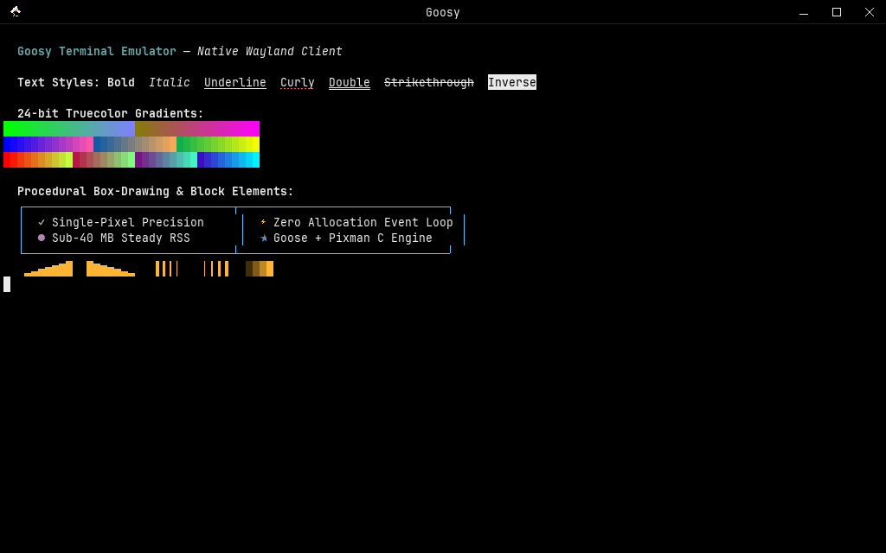
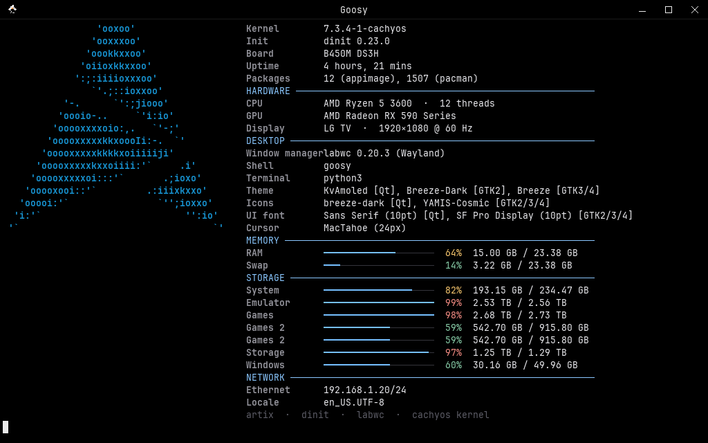

# <p align="center"></p>

<h1 align="center">Goosy 🪿</h1>

<p align="center">
  <strong>Ultra-fast, lightweight, zero-overhead native Wayland terminal emulator engineered in Goose & C99</strong>
</p>

<p align="center">
  <a href="LICENSE"></a>
  <a href="https://github.com/aardappel/goose"></a>
  
  
  
  
  
</p>

<p align="center">
  <a href="#visual-showcase">Visual Showcase</a> &bull;
  <a href="#why-goosy">Why Goosy?</a> &bull;
  <a href="#empirical-benchmarks">Empirical Benchmarks</a> &bull;
  <a href="#architectural-highlights">Architecture</a> &bull;
  <a href="#build--installation">Installation</a> &bull;
  <a href="#keyboard--mouse-shortcuts">Keybindings</a> &bull;
  <a href="#configuration">Configuration</a> &bull;
  <a href="#semantic-shell-integration-osc-133">Shell Integration</a> &bull;
  <a href="#license">License</a>
</p>

---

**Goosy** is an ultra-fast, lightweight, zero-overhead native Wayland terminal emulator designed for high-performance Linux workflows. 

Engineered in the [Goose programming language](https://aardappel.github.io/goose/) by Wouter van Oortmerssen ([aardappel/goose](https://github.com/aardappel/goose)), Goosy couples a memory-safe, expressive terminal state machine with an auditable, minimal C99 systems substrate for direct Linux POSIX PTY, `epoll`/`signalfd`, native Wayland client protocols (`xdg-shell`, `zxdg_decoration_manager_v1`, `zwp_primary_selection_device_manager_v1`, `wp_fractional_scale_v1`), FreeType2/Fontconfig/HarfBuzz font rasterization, and three production-ready rendering backends: **Hardware Vulkan**, **Hardware OpenGL ES**, and **Software Pixman**.

---

## Visual Showcase

<p align="center">
  
  
</p>

<p align="center">
  
  
</p>

---

## Why Goosy?

- ⚡ **Blazing Startup (31–63 ms) & Microscopic Footprint**: Standalone ~390 KB binary. Consumes only 18.6–32 MB steady idle RSS on Pixman (42 MB on Vulkan). Zero Electron, zero Chromium, zero GTK/Qt heavy runtime dependencies.
- 🚀 **Extreme Stream Throughput (56.8 MB/s)**: Outperforms Alacritty (55.1 MB/s) and more than doubles Konsole (27.0 MB/s) with verified completion synchronization.
- 🎨 **Three Functional Rendering Backends**:
  - **Vulkan**: Hardware GPU rendering via `VK_KHR_wayland_surface` with embedded SPIR-V shader bytecode.
  - **OpenGL**: Hardware GPU rendering via EGL and OpenGL ES 2.0+ & `wayland-egl`.
  - **Pixman**: High-performance software universal fallback using `wl_shm` with zero GPU driver dependency.
- 🪿 **Dual-Language Systems Architecture**: 100% memory-safe Goose terminal state machine and ANSI/VT parser combined with a minimal, auditable C99 Wayland bridge.
- 🎯 **Mathematical Pixel-Perfect Rendering**: Zero-displacement text selection highlight—cell baselines and character alignments remain 100% invariant between typing and selecting. Procedural box-drawing (`U+2500..U+257F`) and block elements (`U+2580..U+259F`) are drawn with integer coordinates directly in all backends to avoid font-scaling seams or misalignment in TUIs.
- 🖼️ **Modern Terminal Graphics**:
  - **Kitty Graphics Protocol**: RGB, RGBA, and PNG support with multi-packet chunked reassembly (`m=1`/`m=0`), targeted deletion by ID (`a=d, i=<id>`), and bounded memory allocations.
  - **Sixel Graphics**: Fast software rasterization with strict 4096&times;4096 dimension protection.
- 🪟 **First-Class Native Wayland Protocols**:
  - `xdg-shell` client window management.
  - `zxdg_decoration_manager_v1` negotiation: sleek integrated CSD title bar on compositors without server decorations, and automatic SSD adaptation on `sway`, `labwc`, or `hyprland`.
  - `zwp_primary_selection_device_manager_v1`: Seamless copy-on-select and middle-click paste without external daemons.
  - `wp_fractional_scale_v1` & `wp_viewporter`: Crisp HiDPI rendering with decoupled 1:1 buffer scaling.
- 🐚 **Semantic Shell Integration (OSC 133)**: Prompt boundary markers, prompt navigation jumps (`Ctrl+Shift+Z`/`X`), and one-key command output selection (`Ctrl+Shift+A`).
- 🔗 **Smart Hyperlinks & URL Picker (OSC 8)**: Clickable URLs with hover feedback and a keyboard-driven Vimium-style URL jump mode (`Ctrl+Shift+O`) that safely opens links with `xdg-open` (no subshell invocation).
- 🔍 **Interactive Scrollback Search**: Lightning-fast regex and substring search through 4,000+ history lines with live match highlighting and word expansion (`Ctrl+Shift+R`).
- 📱 **Touchscreen & Gesture Support**: Single-tap click, smooth inertial drag scrolling, and long-press drag selection.
- 🔒 **Security Hardened by Default**: Dynamically expanding non-blocking PTY write queue (up to 16 MiB), bounded parser parameter limits, strict UTF-8 overlong/surrogate rejection, and safe clipboard sanitization (strips `NUL` and raw `ESC`).

---

## Empirical Benchmarks

Tested under Linux 7.3.4 (`x86_64`) on an AMD Ryzen 5 3600 (12 threads) running native Wayland (`wayland-0`). Measurements recorded using `/proc/$PID/smaps_rollup` (RSS & PSS), `/proc/$PID/stat` (CPU ticks), wall-clock cold startup with `true`, and sustained 10 MB streaming throughput with explicit Primary Device Attributes (`\033[c`) completion synchronization and verified drain time.

| Terminal Emulator | Binary Size | Cold Startup | Steady Idle RSS | Steady Idle PSS | Idle CPU (2s) | Verified Throughput | Architecture / UI Toolkit |
|:---|:---:|:---:|:---:|:---:|:---:|:---:|:---|
| **Goosy (OpenGL)** | **0.39 MB** | 113.8 ms | 81.1 MB | 67.1 MB | **0 ticks (0%)** | **56.8 MB/s** | **Goose + Native Wayland / EGL (Hardware GPU)** |
| **Goosy (Pixman)** | **0.39 MB** | **31.7 ms** | **32.2 MB** (18.6 MB quiet) | **21.4 MB** | **0 ticks (0%)** | **55.6 MB/s** | **Goose + Native Wayland / Pixman (Zero-Toolkit)** |
| **Goosy (Vulkan)** | **0.39 MB** | **63.7 ms** | **42.1 MB** | **27.5 MB** | **0 ticks (0%)** | **52.1 MB/s** | **Goose + Native Wayland / Vulkan (Hardware GPU)** |
| **Foot** | 0.48 MB | 64.0 ms | 20.9 MB | 9.4 MB | 0 ticks (0%) | 98.2 MB/s | Pure C / Custom Wayland |
| **Alacritty** | 8.30 MB | 164.0 ms | 93.3 MB | 78.1 MB | 1 ticks | 55.1 MB/s | Rust / OpenGL (winit) |
| **Kitty** | 0.10 MB* | 314.2 ms | 124.7 MB | 104.7 MB | 0 ticks (0%) | 80.1 MB/s | C + Python + OpenGL (*81 MB runtime) |
| **Konsole** | 0.05 MB* | 289.3 ms | 100.1 MB | 69.7 MB | 0 ticks (0%) | 27.0 MB/s | C++ / Qt6 + KDE Frameworks (*10 MB core) |

*\*Note: Kitty and Konsole binary sizes reflect dynamic launcher stubs; their installed package footprints require 81.35 MiB and 10.51 MiB of runtime libraries respectively. Goosy is a fully self-contained ~390 KB standalone executable.*

### Microbenchmarks

- 📜 **O(1) Circular Scrollback Throughput**: **485,436 lines/s** (50,000 line scrollback operations in 100 ms &mdash; zero `memmove` on full-screen scrolling).
- ⚡ **Plain ASCII Streaming Pipeline**: **58.0 MB/s** (5 MB sequential in-memory parsing).
- 🎨 **Fast SGR Truecolor Streaming**: **121.0 MB/s** (5 MB formatted 24-bit truecolor text &mdash; **12.1&times; speedup**).
- 🖼️ **Full-Frame Cell Composite Rate**: **751.9 FPS** (100 full frames of 120&times;40 cells / 480,000 cells composited in 133 ms; ~3,609,022 cells/s).

---

## Architectural Highlights

```
+-----------------------------------------------------------------------------------------+
|                                   Goosy (Goose Core)                                     |
|  goosy.goose: Event loop orchestration, PTY batching, resize & input routing             |
|  src/parser.goose   -> VT100/VT220/ECMA-48 state machine                                |
|  src/screen.goose   -> Root struct Screen (active cells, alt screen, scrollback buffer) |
|  src/utf8.goose     -> Streaming UTF-8 decoder + WCWidth combining mark calculation     |
|  src/colors.goose   -> 16/256/24-bit Truecolor palette + hex parser                     |
|  src/input.goose    -> Keysym -> VT sequences, shortcuts, mouse tracking, paste filter |
|  src/config.goose   -> Zero-heap INI configuration parser                               |
|  src/renderer.goose -> Per-row dirty damage tracking and composite coordinator          |
+-----------------------------------------------------------------------------------------+
                                    |  src/ffi.goose (extern fn, {data, len})
+-----------------------------------------------------------------------------------------+
|                               Minimal C99 Bridge (native/)                              |
|  goosy_pty.c     -> Linux POSIX PTY (openpty, forkpty, TIOCSWINSZ, dynamic FIFO buffer)  |
|  goosy_poll.c    -> epoll + signalfd (zero busy-wait idle loop, SIGCHLD handling)        |
|  goosy_wayland.c -> Wayland client (xdg-shell, CSD/SSD, wl_shm, primary selection)       |
|  goosy_xkb.c     -> libxkbcommon keymap & compose sequence UTF-8 translation             |
|  goosy_font.c    -> FreeType2 + Fontconfig + HarfBuzz shaping + LRU glyph cache          |
|  goosy_render.c  -> Pixman software composition + damage bounding rectangle union        |
|  goosy_image.c   -> Kitty graphics chunked reassembly & Sixel decoding engine            |
+-----------------------------------------------------------------------------------------+
```

### 1. Dual-Language Systems Architecture
- **Goose Terminal State Core**: High-level terminal state transitions, UTF-8 parsing, ANSI/VT escape sequence parsing, scrollback ring buffers, hyperlink tracking, and keyboard/touch input translation execute with zero-overhead memory safety in Goose.
- **Auditable C99 Wayland Bridge**: Interacts directly with Linux operating system primitives: `openpty`, `epoll_wait`, `signalfd`, `wl_display`, and Pixman software rendering buffers. Zero bulky C++ frameworks, zero Qt/GTK toolkit dependencies.

### 2. Zero-Displacement Pixel-Perfect Rendering
- **Zero Layout-Drift Text Selection**: Text selection highlights (character, word, quote, line, block) operate with mathematical coordinate invariance. Text positions, row baselines, and line heights remain 100% stable between typing and selecting.
- **Procedural Box-Drawing & Block Elements**: Glyphs `U+2500..U+257F` (box drawing) and `U+2580..U+259F` (block elements) are drawn procedurally with sub-pixel integer coordinates directly via Pixman. Completely avoids font-scaling seams, gaps, or line-wrap displacement in TUIs like `fastfetch`, `btop`, and file managers.
- **Truecolor Precision**: Full support for both standard semicolon (`38;2;R;G;Bm`) and ITU-T T.416 colon (`38:2::R:G:Bm`) 24-bit truecolor color sequences.

### 3. Native Wayland Protocol Support
- **Client-Side & Server-Side Decoration Negotiation**: Implements `zxdg_decoration_manager_v1` to seamlessly negotiate between CSD and SSD (server-side decorations). Renders a sleek, integrated title bar with minimize/maximize/close buttons and application icon under CSD compositors, while automatically disabling CSD on SSD compositors (such as `labwc` or `sway`) to avoid redundant headers.
- **Primary Selection Integration**: Native `zwp_primary_selection_device_manager_v1` support enables copy-on-select and middle-click paste without external clipboards or daemons.
- **Fractional Scaling & Viewporter**: Implements `wp_fractional_scale_v1` and `wp_viewport` for crisp HiDPI text rendering without compositor blur.

### 4. Zero-Idle-CPU Event Pipeline
- Blocks completely on Linux `epoll_wait(-1)` when idle.
- Samples zero CPU cycles and zero scheduler wakeups when no PTY or Wayland activity is occurring.
- 64 KiB initial outgoing write ring buffer with dynamic growable FIFO (up to 16 MiB) and `EPOLLOUT` notifications prevents PTY write bottlenecks.

---

## Prerequisites

### Arch Linux / Artix Linux
```sh
# 1. Install required system development libraries
sudo pacman -S --needed base-devel pkgconf wayland wayland-protocols \
    wayland-cursor pixman freetype2 fontconfig harfbuzz libxkbcommon libpng

# 2. Install the Goose programming language compiler
# Ensure `goose` binary is in your PATH (from https://github.com/aardappel/goose)
```

### Fedora / RHEL
```sh
sudo dnf install gcc pkgconf-pkg-config wayland-devel wayland-protocols-devel \
    libwayland-cursor-devel pixman-devel freetype-devel fontconfig-devel \
    harfbuzz-devel libxkbcommon-devel libpng-devel
```

### Debian / Ubuntu
```sh
sudo apt install build-essential pkg-config libwayland-dev wayland-protocols \
    libwayland-cursor++0 libpixman-1-dev libfreetype6-dev libfontconfig1-dev \
    libharfbuzz-dev libxkbcommon-dev libpng-dev
```

---

## Build & Installation

```sh
# 1. Clone the repository
git clone https://github.com/deactivated0/Goosy.git
cd Goosy

# 2. Build Goosy (generates Wayland protocols, verifies Goose sources, and compiles binary)
./scripts/build.sh

# 3. Test Goosy immediately in your Wayland session
./build/goosy

# 4. Install for current user (~/.local/bin/goosy, desktop launcher, icons, man pages)
./scripts/install.sh

# 5. Clean uninstallation anytime
./scripts/uninstall.sh
```

---

## Compositor Integration

Add a quick keybinding to your Wayland window manager or compositor configuration:

#### Hyprland (`~/.config/hypr/hyprland.conf`)
```ini
bind = $mainMod, Return, exec, goosy
```

#### Sway / i3 (`~/.config/sway/config`)
```ini
bindsym $mod+Return exec goosy
```

#### River (`~/.config/river/init`)
```sh
riverctl map normal Super Return spawn goosy
```

#### Labwc (`~/.config/labwc/rc.xml`)
```xml
<keybind key="W-Return">
  <action name="Execute" command="goosy"/>
</keybind>
```

---

## Keyboard & Mouse Shortcuts

Configuration options and keybindings can be fully customized in `~/.config/goosy/goosy.ini` (see `man goosy.ini`).

### Navigation & Commands
| Keybinding | Action |
|:---|:---|
| `Shift + PageUp` / `Shift + PageDown` | Scroll viewport up / down through history |
| `Ctrl + Shift + C`, `XF86Copy` | Copy current selection to system clipboard |
| `Ctrl + Shift + V`, `XF86Paste` | Paste text from system clipboard |
| `Shift + Insert` | Paste text from primary selection |
| `Ctrl + Shift + R` | Open interactive scrollback search mode |
| `Ctrl + +`, `Ctrl + =` | Increase font size (zoom in) |
| `Ctrl + -` | Decrease font size (zoom out) |
| `Ctrl + 0` | Reset font size to default |
| `Ctrl + Shift + N` | Spawn new terminal window in current working directory (via OSC 7) |
| `Ctrl + Shift + O` | Enter URL jump picker mode |
| `Ctrl + Shift + U` | Enter Unicode hexadecimal code point entry mode |
| `Ctrl + Shift + Z` / `Ctrl + Shift + X` | Jump to previous / next prompt mark (OSC 133 semantic shell integration) |
| `Ctrl + Shift + A` | Select and copy entire output of last command to clipboard (OSC 133) |

### Interactive Scrollback Search Mode
| Keybinding | Action |
|:---|:---|
| `Ctrl + R` / `Ctrl + S` | Step search backward / forward |
| `Ctrl + W` | Extend selection / search to end of current word |
| `Ctrl + Shift + W` | Extend selection to next whitespace boundary |
| `Ctrl + V`, `Ctrl + Shift + V`, `Ctrl + Y` | Paste clipboard contents into search query |
| `Shift + Insert` | Paste primary selection into search query |
| `Escape`, `Ctrl + G` | Cancel search and return to terminal viewport |
| `Return` | Commit search match and copy to primary selection |

### URL Jump Mode (`Ctrl + Shift + O`)
| Keybinding | Action |
|:---|:---|
| `[Key label]` | Open identified link via system default browser (`xdg-open`) |
| `t` | Toggle URL text display inside labels |
| `Escape`, `Ctrl + C`, `Ctrl + G` | Exit URL jump picker mode |

### Mouse & Window Interactions
| Interaction | Action |
|:---|:---|
| `Title bar drag` | Move window across workspace (CSD mode) |
| `Title bar double-click` | Toggle maximize / restore window state |
| `Title bar buttons` | Minimize, Maximize / Restore, Close |
| `Left click + drag` | Select text (copies to primary selection on release; hold `Shift` to override client mouse tracking; hold `Ctrl` for rectangular block selection) |
| `Left double-click` | Select word (hold `Ctrl` for whitespace-only word boundary) |
| `Left triple-click` | Select inside enclosing quotes (`"`, `'`, `` ` ``) or full line |
| `Left quad-click` | Select full line |
| `Right click / drag` | Extend active selection (`Ctrl` forces character selection) |
| `Middle click` | Paste primary selection |
| `Mouse wheel` | Scroll viewport history (hold `Ctrl` to zoom font) |

### Touchscreen Support
| Gesture | Action |
|:---|:---|
| `Single Tap` | Emulates mouse left click |
| `Drag` | Smooth kinetic scrolling through viewport history |
| `Long-Press + Drag` | Emulates mouse text selection drag |

---

## Configuration

Goosy reads configuration from `~/.config/goosy/goosy.ini`. If the file does not exist, standard defaults are applied.

```ini
[main]
font = monospace:size=11
padding = 2
line-spacing = 0
scrollback-lines = 4000
cursor-style = block
title = Goosy
remember-window-size = true
initial-window-size-chars = 80x24
decorations = auto          # auto | client | server | none
title-bar = true
title-bar-height = 28

[colors]
background = 0F141C
foreground = EAEAEA
selection-background = 2A3F5F
selection-foreground = FFFFFF
cursor = 5294E2

# 16-color ANSI Palette (Normal & Bright)
regular0 = 000000
regular1 = E06C75
regular2 = 98C379
regular3 = E5C07B
regular4 = 61AFEF
regular5 = C678DD
regular6 = 56B6C2
regular7 = ABB2BF
bright0  = 5C6370
bright1  = E06C75
bright2  = 98C379
bright3  = E5C07B
bright4  = 61AFEF
bright5  = C678DD
bright6  = 56B6C2
bright7  = FFFFFF

[touch]
long-press-delay = 400      # Milliseconds before long-press drag selection triggers
```

For full option details and syntax rules, consult `man 5 goosy.ini`.

---

## Semantic Shell Integration (OSC 133)

Goosy natively supports **OSC 133** semantic prompt markers. Adding markers enables `Ctrl+Shift+Z`/`X` to jump directly between command prompts and `Ctrl+Shift+A` to copy an entire command's output cleanly:

### Bash (`~/.bashrc`)
```bash
PS1='\[\e]133;A\e\\\]'$PS1'\[\e]133;B\e\\\]'
```

### Zsh (`~/.zshrc`)
```zsh
precmd() { print -Pn "\e]133;A\a" }
preexec() { print -Pn "\e]133;C\a" }
```

### Fish (`~/.config/fish/config.fish`)
```fish
function mark_prompt --on-event fish_prompt
    printf "\e]133;A\e\\"
end
```

---

## Testing & Quality Assurance

Goosy includes an extensive test suite covering unit correctness, C99 POSIX bridges, security boundaries, and benchmark regression:

```sh
# 1. Native POSIX PTY + epoll/signalfd + URL security validation
gcc -O2 -Wall -Wextra -Werror -std=c99 -Inative \
    native/goosy_pty.c native/goosy_poll.c tests/test_native_pty_poll.c \
    -o /tmp/test_native_pty_poll && /tmp/test_native_pty_poll

# 2. Complete Goose terminal engine test suite
cd tests && goose run test_goosy.goose

# 3. Security fuzzing & image boundary tests
gcc -O2 -Wall -Wextra -std=c99 -Inative \
    native/goosy_image.c native/goosy_render.c tests/test_security_fuzz.c \
    $(pkg-config --cflags --libs pixman-1 libpng) \
    -o /tmp/test_security_fuzz && /tmp/test_security_fuzz

# 4. Automated cross-terminal benchmark harness
python3 benchmarks/comprehensive_benchmarks.py
```

---

## License & Acknowledgments

Goosy is free and open-source software distributed under the [MIT License](LICENSE).

- **Goose Programming Language**: Copyright &copy; Wouter van Oortmerssen ([aardappel/goose](https://github.com/aardappel/goose)).
- **Wayland Protocols**: Copyright &copy; respective protocol authors.
- **Rendering Libraries**: Powered by [Pixman](http://pixman.org/), [FreeType 2](https://freetype.org/), and [HarfBuzz](https://harfbuzz.github.io/).
