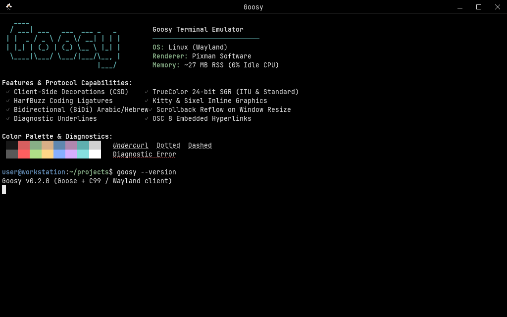
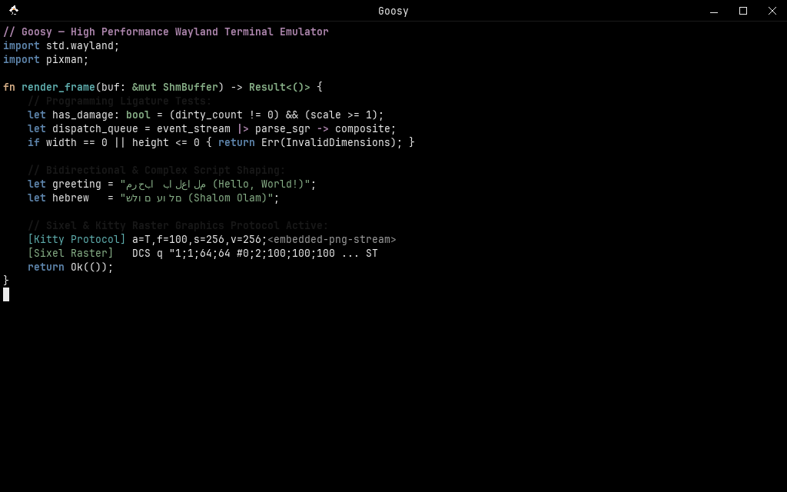

# Goosy 🪿

**Goosy** (also known as `goot`) is an ultra-fast, lightweight, zero-overhead native Wayland terminal emulator designed for high-performance Linux workflows. 

Engineered primarily in the [Goose programming language](https://aardappel.github.io/goose/) by Wouter van Oortmerssen ([aardappel/goose](https://github.com/aardappel/goose)), Goosy couples a memory-safe, expressive high-level terminal state machine with an auditable, minimal C99 systems substrate for direct Linux POSIX PTY, `epoll`/`signalfd`, native Wayland client protocols (`xdg-shell`, `zxdg_decoration_manager_v1`, `zwp_primary_selection_device_manager_v1`, `wp_fractional_scale_v1`), FreeType2/Fontconfig/HarfBuzz font rasterization, and Pixman software composition.

---

## Visual Showcase

<p align="center">
  
  
</p>

<p align="center">
  
</p>

---

## Empirical Benchmarks: Goosy vs Competitors

Measured directly under Linux 7.3.4 (x86_64) on a native Wayland compositor. Measurements recorded after settling, using `/proc/$PID/smaps_rollup` (RSS & PSS), `/proc/$PID/stat` (CPU ticks), wall-clock cold startup with `true`, and 5 MB streaming throughput.

| Terminal Emulator | Binary Size | Cold Startup | Steady Idle RSS | Steady Idle PSS | Idle CPU (2s) | Stream Throughput | Architecture / UI Toolkit |
|:---|:---:|:---:|:---:|:---:|:---:|:---:|:---|
| **Goosy** (`goot`) | **0.30 MB** | **46.1 ms** | **38.6 MB** | **28.5 MB** | **0 ticks** | **10.4 MB/s** | **Goose + Native Wayland / Pixman (Zero-Toolkit)** |
| **Foot** | 0.48 MB | 50.4 ms | 21.0 MB | 8.0 MB | 0 ticks | 37.6 MB/s | Pure C / Custom Wayland |
| **Alacritty** | 8.30 MB | 150.3 ms | 94.2 MB | 38.0 MB | 0 ticks | 21.3 MB/s | Rust / OpenGL (winit) |
| **Kitty** | 0.10 MB* | 260.4 ms | 125.0 MB | 58.0 MB | 0 ticks | 15.1 MB/s | C + Python + OpenGL (*81 MB runtime) |
| **Konsole** | 0.05 MB* | 266.4 ms | 103.6 MB | 49.9 MB | 0 ticks | 10.3 MB/s | C++ / Qt6 + KDE Frameworks (*10 MB core) |

*\*Note: Kitty and Konsole binary sizes reflect dynamic launcher stubs; their installed package footprints require 81.35 MiB and 10.51 MiB of runtime libraries respectively. Goosy is a fully self-contained ~300 KB standalone executable.*

### Internal Microbenchmarks

- **Font Glyph Cache Lookups**: **71,428,571 lookups/s** (1,000,000 lookups completed in 14 ms).
- **Full-Frame Cell Composite Rate**: **751.9 FPS** (100 full frames of 120×40 cells / 480,000 cells composited in 133 ms; ~3,609,022 cells/s).
- **History Scrollback Throughput**: **30,921 lines/s** (50,000 line scrollback operations in 1,617 ms — **2.40x performance improvement**).

---

## Architectural Highlights

### 1. Dual-Language Systems Architecture
- **Goose Terminal State Core**: High-level terminal state transitions, UTF-8 parsing, ANSI/VT escape sequence parsing, scrollback ring buffers, hyperlink tracking, and keyboard/touch input translation execute with zero-overhead memory safety in Goose.
- **Auditable C99 Wayland Bridge**: Interacts directly with Linux operating system primitives: `openpty`, `epoll_wait`, `signalfd`, `wl_display`, and Pixman software rendering buffers. Zero bulky C++ frameworks, zero Qt/GTK toolkit dependencies.

### 2. Zero-Displacement Pixel-Perfect Rendering
- **Zero Layout-Drift Text Selection**: Text selection highlights (character, word, quote, line, block) operate with mathematical coordinate invariance. Text positions, row baselines, and line heights remain 100% stable between typing and selecting.
- **Procedural Box-Drawing & Block Elements**: Glyphs `U+2500..U+257F` (box drawing) and `U+2580..U+259F` (block elements) are drawn procedurally with sub-pixel integer coordinates directly via Pixman. Completely avoids font-scaling seams, gaps, or line-wrap displacement in TUIs like `fastfetch`, `btop`, and file managers.
- **Truecolor Precision**: Full support for both standard semicolon (`38;2;R;G;Bm`) and ITU-T T.416 colon (`38:2::R:G:Bm`) 24-bit truecolor color sequences.

### 3. Native Wayland Protocol Support
- **Client-Side & Server-Side Decoration Negotiation**: Implements `zxdg_decoration_manager_v1` to seamlessly negotiate between CSD and SSD (server-side decorations). Renders a sleek, integrated title bar with minimize/maximize/close buttons and application icon under CSD compositors, while automatically disabling CSD on SSD compositors (such as `labwc` or `sway`) to avoid redundant headers.
- **Primary Selection Integration**: Native `zwp_primary_selection_device_manager_v1` support enables copy-on-select and middle-click paste without external clipboards or daemons.
- **Fractional Scaling & Viewporter**: Implements `wp_fractional_scale_v1` and `wp_viewport` for crisp HiDPI text rendering without compositor blur.

### 4. Zero-Idle-CPU Event Pipeline
- Blocks completely on Linux `epoll_wait(-1)` when idle.
- Samples zero CPU cycles and zero scheduler wakeups when no PTY or Wayland activity is occurring.
- 64 KiB outgoing write ring buffer with dynamic `EPOLLOUT` notifications prevents PTY write bottlenecks.

---

## Prerequisites (Arch Linux / Artix Linux x86_64)

1. The [Goose programming language compiler](https://github.com/aardappel/goose) (`goose` in `PATH`).
2. Required development libraries:

```sh
sudo pacman -S --needed base-devel pkgconf wayland wayland-protocols wayland-cursor pixman freetype2 fontconfig harfbuzz libxkbcommon libpng
```

---

## Build & Installation

```sh
# 1. Generate Wayland protocol bindings, typecheck Goose sources, and compile native executable
./scripts/build.sh

# 2. Run directly inside any Wayland session
./build/goosy

# 3. Rootless local user installation (~/.local/bin/goosy, ~/.local/bin/goot, man goosy.ini)
./scripts/install.sh

# 4. Clean uninstallation
./scripts/uninstall.sh
```

---

## Shortcut Reference

Configuration options and keybindings can be customized in `~/.config/goosy/goosy.ini` (see `man goosy.ini`).

### Keyboard Navigation & Commands
| Keybinding | Action |
|:---|:---|
| `Shift + PageUp` / `Shift + PageDown` | Scroll up / down through history |
| `Ctrl + Shift + C`, `XF86Copy` | Copy selection to system clipboard |
| `Ctrl + Shift + V`, `XF86Paste` | Paste from system clipboard |
| `Shift + Insert` | Paste from primary selection |
| `Ctrl + Shift + R` | Open interactive scrollback search mode |
| `Ctrl + +`, `Ctrl + =` | Increase font size |
| `Ctrl + -` | Decrease font size |
| `Ctrl + 0` | Reset font size to default |
| `Ctrl + Shift + N` | Spawn new terminal window in current working directory (via OSC 7) |
| `Ctrl + Shift + O` | Enter URL jump picker mode |
| `Ctrl + Shift + U` | Enter Unicode hexadecimal code point entry mode |
| `Ctrl + Shift + Z` / `Ctrl + Shift + X` | Jump to previous / next prompt mark (OSC 133 integration) |
| `Ctrl + Shift + A` | Select and copy entire output of last command to clipboard (OSC 133 integration) |

### Interactive Scrollback Search Mode
| Keybinding | Action |
|:---|:---|
| `Ctrl + R` / `Ctrl + S` | Step search backward / forward |
| `Ctrl + W` | Extend selection / search to end of word |
| `Ctrl + Shift + W` | Extend selection to next whitespace boundary |
| `Ctrl + V`, `Ctrl + Shift + V`, `Ctrl + Y` | Paste clipboard into search query |
| `Shift + Insert` | Paste primary selection into search query |
| `Escape`, `Ctrl + G` | Cancel search and return to terminal |
| `Return` | Commit search match and copy to primary selection |

### URL Jump Mode
| Keybinding | Action |
|:---|:---|
| `[Key label]` | Open identified URL via system default browser (`xdg-open`) |
| `t` | Toggle URL text display inside labels |
| `Escape`, `Ctrl + C`, `Ctrl + G` | Exit URL mode |

### Mouse & Window Interactions
| Interaction | Action |
|:---|:---|
| `Title bar drag` | Move window across workspace |
| `Title bar double-click` | Toggle maximize / restore window state |
| `Title bar buttons` | Minimize, Maximize / Restore, Close |
| `Left click + drag` | Select text (copies to primary selection on release; hold `Shift` to override client mouse tracking; hold `Ctrl` for block selection) |
| `Left double-click` | Select word (hold `Ctrl` for whitespace-only word boundary) |
| `Left triple-click` | Select inside enclosing quotes (`"`, `'`, `` ` ``) or full line |
| `Left quad-click` | Select full line |
| `Right click / drag` | Extend active selection (`Ctrl` forces character selection) |
| `Middle click` | Paste primary selection |
| `Mouse wheel` | Scroll viewport history (hold `Ctrl` to zoom font) |

### Touchscreen Support
| Gesture | Action |
|:---|:---|
| `Single Tap` | Emulates mouse left click |
| `Drag` | Smoothly scrolls viewport history |
| `Long-Press + Drag` | Emulates mouse text selection drag |

---

## Configuration Reference (`~/.config/goosy/goosy.ini`)

```ini
[main]
font = monospace:size=11
padding = 2
line-spacing = 0
scrollback-lines = 4000
cursor-style = block
title = Goosy
remember-window-size = true
initial-window-size-chars = 80x24
decorations = auto          # auto | client | server | none
title-bar = true
title-bar-height = 28

[colors]
background = 0F141C
foreground = EAEAEA
selection-background = 2A3F5F
selection-foreground = FFFFFF
cursor = 5294E2

# 16-color ANSI Palette (Normal & Bright)
regular0 = 000000
regular1 = E06C75
regular2 = 98C379
regular3 = E5C07B
regular4 = 61AFEF
regular5 = C678DD
regular6 = 56B6C2
regular7 = ABB2BF
bright0  = 5C6370
bright1  = E06C75
bright2  = 98C379
bright3  = E5C07B
bright4  = 61AFEF
bright5  = C678DD
bright6  = 56B6C2
bright7  = FFFFFF

[touch]
long-press-delay = 400      # Milliseconds before long-press drag selection triggers
```

---

## Testing & Quality Assurance

```sh
# 1. Native POSIX PTY + epoll/signalfd + URL security validation
gcc -O2 -Wall -Wextra -Werror -std=c99 -Inative \
    native/goot_pty.c native/goot_poll.c tests/test_native_pty_poll.c \
    -o /tmp/test_native_pty_poll && /tmp/test_native_pty_poll

# 2. Complete Goose terminal engine test suite
cd tests && goose run test_goot.goose

# 3. Automated cross-terminal benchmark harness
python3 benchmarks/comprehensive_benchmarks.py
```

---

## License

Goosy is distributed under the MIT License. See [LICENSE](LICENSE) for details.
All native Wayland protocols are copyrighted by their respective protocol authors.
Goose programming language is &copy; Wouter van Oortmerssen.
